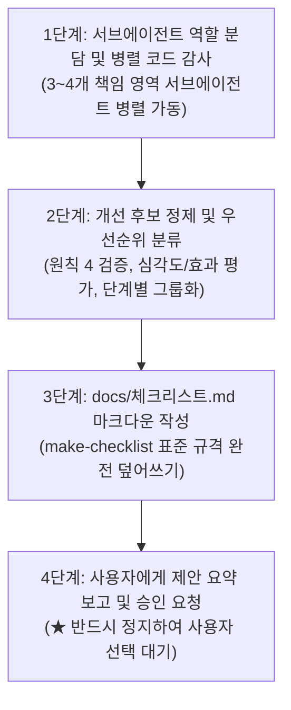
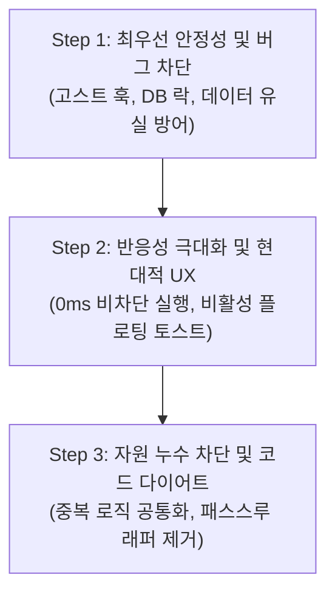

# 코드 패턴 현대화 스킬 (Modernize Code Patterns)

이 스킬은 프로젝트 내의 구형 관행, 임시방편 우회 로직, 블로킹 I/O, 고정 딜레이, 자원 누수, 취약한 환경 종속 코드 등을 전수 조사하여 **"동작은 동일하게 유지하면서도 더 빠르고, 효율적이며, 이식성이 높고, 사용자 경험(UX)이 뛰어난 현대식 코드"**로 개선할 수 있는 방안을 발굴하고, 이를 표준 체크리스트(`docs/체크리스트.md`)로 문서화하여 사용자에게 제안하는 절차를 규정합니다.

---

## 🎯 핵심 원칙 (Core Principles)

### 원칙 1. 제안 및 체크리스트 작성까지만 수행 (코드 임의 수정 절대 금지)
> [!IMPORTANT]
> **사용자의 명시적 승인 없이 실제 소스 코드를 수정하거나 리팩터링하지 마십시오.**  
> 이 스킬의 임무는 코드를 정밀 진단하고 현대화 방안을 발굴하여 **`docs/체크리스트.md`로 정리한 뒤 사용자에게 선택지를 보고하는 것까지**입니다. 실제 코드 수정은 사용자가 제안을 검토하고 특정 항목 또는 단계를 승인한 후 별도 턴에서 진행합니다.

### 원칙 2. 서브에이전트 병렬 활용 (Parallel Subagent Orchestration)
단일 에이전트가 수만 줄의 전체 코드를 혼자 읽으려 하면 컨텍스트 윈도우가 급격히 소진되어 깊이 있는 분석을 놓치게 됩니다. 코드베이스를 책임 영역별(예: ① 실행·외부 연동·네이티브 API, ② UI·UX·렌더링·입력 훅, ③ 아키텍처·영속성·상태 관리)로 분할하여 **3~4기의 서브에이전트를 병렬 가동(`invoke_subagent`)**함으로써 철저하고 신속하게 전수 조사를 수행합니다.

### 원칙 3. 특정 기술/사례에 국한되지 않는 범용성 (Cross-Platform & Universal)
Windows 데스크톱(C#/WPF/Win32), 모바일(Android Kotlin/Compose), 웹/백엔드(TypeScript/Node/Spring) 등 어떤 기술 스택에서도 적용할 수 있는 **6대 범용 현대화 관점**을 기준으로 진단합니다.

### 원칙 4. 동작 보존 + 체감 품질 향상 (Same Behavior, Better Speed & UX)
단순한 코드 모양 변경이나 개인 취향에 기반한 리팩터링은 배제합니다.  
반드시 다음 5가지 중 **최소 하나 이상의 실질적 이득이 명확한 항목**만 선별합니다:
1. **속도 및 반응성 대폭 향상** (블로킹 제거, 0ms 즉각 반환)
2. **취약한 우회로 및 외부 도구 의존성 제거** (OS/플랫폼 네이티브 내재화)
3. **이식성 및 환경 적응력 확보** (기기/모니터/계정 변경 대응)
4. **치명적인 리소스 누수 및 연쇄 폭풍 차단** (결정론적 생명주기 회수, 실패 쿨다운)
5. **사용자 체감 인터랙션 및 UX 품질 개선** (비간섭 피드백, 포커스 보호)

---

## 🔍 6대 범용 현대화 발굴 축 (6 Universal Modernization Axes)

### 📊 6대 축 요약 매트릭스

| 축 | 핵심 현대화 테마 | 주요 탐색 대상 (Code Smells) | 현대화 목표 / 해결 방향 | 기대 효과 |
| :---: | :--- | :--- | :--- | :--- |
| **축 1** | **외부 스크립트·우회로 → 네이티브 API** | `.bat`/`.cmd` 호출, CLI 래핑, 매크로성 입력 에뮬레이션 | 플랫폼 표준 SDK / OS 네이티브 API 직접 호출 | 실행 속도 10~50배 단축, 콘솔 깜빡임 제거 |
| **축 2** | **동기 블로킹·고정 딜레이 → 비차단 비동기** | UI 스레드 동기 I/O, `Thread.Sleep`, 고정 시간 대기 | 비동기 백그라운드 위임, 이벤트 기반 통지, 즉시 반환 | UI 프리징(0ms 반응), 연속 입력/단축키 씹힘 방지 |
| **축 3** | **환경 종속·하드코딩 → 표준 식별자·토큰** | 절대 경로, 머신 종속 암호화, 고정 픽셀/색상 | 표준 식별자(AUMID, 패키지명), 환경 변수, 디자인 토큰 | PC 이동 시 데이터 보존, 멀티 모니터/DPI 대응 |
| **축 4** | **무응답·포커스 강탈 UX → 무방해 반응형 피드백** | 작업 중 창 멈춤, 키보드 포커스 강탈 모달, 침묵 실패 | 비활성 토스트/스낵바(`WS_EX_NOACTIVATE`), 0ms 창 닫힘 | 작업 흐름 단절 차단, 진행률·결과 실시간 피드백 |
| **축 5** | **자원 누수·고스트·폭풍 → 생명주기·방어 캐싱** | 방치된 전역 훅/리스너, 미해제 핸들, 무한 재시도 루프 | 컴포넌트 생명주기 회수(`Dispose`), 예외 쿨다운, DB WAL | 타 앱 키 충돌 차단, 메모리/CPU/디스크 누수 방지 |
| **축 6** | **중복·비대·과도한 추상화 → 코드 단순화** | 대규모 코드 복붙, 1회성 인터페이스, 1줄짜리 래퍼 | 공통 로직 합성, 불필요한 추상화 제거, 파일 비대화 해소 | 코드 라인 30~50% 절감, 유지보수 복잡도 급감 |

---

### 축 1. 외부 스크립트·우회로 → 네이티브/표준 API 내재화 (Workarounds → Native APIs)

과거 개발 단계에서 빠른 프로토타이핑을 위해 셸 스크립트나 외부 CLI를 호출하던 방식은 프로세스 생성 비용이 크고 환경에 따라 쉽게 깨집니다.

- **탐색 대상 (Code Smells)**:
  - `.bat`, `.cmd`, `.ps1`, `.sh` 등의 셸 스크립트 파일을 디스크에 생성하거나 실행하는 코드.
  - 외부 CLI 유틸리티(`Process.Start("cmd.exe", ...)`, `Runtime.getRuntime().exec(...)`)를 서브프로세스로 띄워 결과를 문자열로 파싱하는 패턴.
  - 실제 대상 앱이나 서비스와 통신하지 못해 가상 키 입력(`SendKeys`, `Robot`, `adb shell input keyevent`)이나 클립보드 경유로 우회하는 패턴.
  - 대상 상태를 읽기 위해 화면 전체 또는 접근성 노드 트리를 주기적으로 덤프하는 패턴.
- **현대화 방향**:
  - 플랫폼 표준 SDK 및 OS 공식 네이티브 API(Win32, WinRT, Android Framework System Service 등)를 직접 호출하도록 내재화합니다.
  - 검증된 표준 런타임 라이브러리(`HttpClient`, 내장 암호화 라이브러리 등)를 활용하여 외부 프로세스 스폰 비용을 제거합니다.
- **플랫폼별 구체적 비교 예시**:
  - **Windows (C#/WPF)**:
    - *구형/우회*: `Process.Start("cmd.exe", "/c start shell:AppsFolder\\AppId!App")` 실행으로 콘솔 검은 창 깜빡임 발생 및 150~300ms 딜레이.
    - *현대화*: COM 인터페이스 `IApplicationActivationManager.ActivateApplication` 직접 호출 또는 `ShellExecuteEx` 호출로 5ms 내 무음 실행.
    - *구형/우회*: 클립보드에 텍스트 복사 후 `SendKeys.SendWait("^v")`로 외부 창에 붙여넣기 시도.
    - *현대화*: `SetForegroundWindow` + 대상 프로세스 스레드 부착(`AttachThreadInput`) 후 네이티브 `SendInput` API 또는 UI Automation 패턴 사용.
  - **Android (Kotlin)**:
    - *구형/우회*: `Runtime.getRuntime().exec("dumpsys accessibility")`로 시스템 상태 확인.
    - *현대화*: `AccessibilityManager`, `UsageStatsManager` 시스템 서비스를 Context로부터 직접 주입받아 API 호출.
  - **일반/웹**:
    - *구형/우회*: 외부 `curl` 명령어를 자식 프로세스로 실행하여 출력 파싱.
    - *현대화*: 프레임워크 내장 `HttpClient` / `fetch` 사용 및 스트리밍 응답 파싱.

---

### 축 2. 동기 블로킹·고정 딜레이 → 비차단 비동기 & 이벤트 기반 고속화 (Blocking & Fixed Delays → Non-Blocking & Event-Driven)

UI나 메인 흐름에서 동기 작업이나 임의의 시간 지연을 사용하는 코드는 사용자 체감 성능을 심각하게 떨어뜨립니다.

- **탐색 대상 (Code Smells)**:
  - UI/메인 스레드에서 수행되는 파일 I/O, SQLite 트랜잭션, 네트워크 통신, 외부 프로세스 대기.
  - 타이밍 문제를 회피하기 위해 삽입된 고정 딜레이 (`Thread.Sleep(300)`, `Task.Delay(500)`, `delay(500L)`).
  - 메서드의 `finally` 블록에서 다음 입력이나 호출을 막는 동기 슬립 또는 긴 락 점유.
- **현대화 방향**:
  - 메인 인터랙션 흐름은 즉시 반환(0ms)하고, 무거운 작업은 백그라운드 태스크로 즉시 위임합니다.
  - 고정된 시간 대기는 **상태 변화를 즉시 감지하는 이벤트 구독**이나 **조건 충족 시 즉각 탈출하는 짧은 폴링(Spin-wait/Polling with Timeout)**으로 전환합니다.
- **플랫폼별 구체적 비교 예시**:
  - **Windows (C#/WPF)**:
    - *구형/우회*: 단축키나 팔레트 항목 클릭 시 셸 실행과 클립보드 정리가 끝날 때까지 대기한 후 창을 닫음 (`Thread.Sleep(500)` 포함).
    - *현대화*: 클릭 즉시 UI 창을 먼저 숨기거나 닫고(`Hide()`/`Close()`), 셸 실행 및 클립보드 정리는 `Task.Run`으로 백그라운드에서 비동기 처리하여 메인 스레드 점유율 제로화.
  - **Android (Kotlin)**:
    - *구형/우회*: Main 스레드에서 `RoomDatabase` 쿼리 동기 호출 또는 `SharedPreferences.apply()` 남발로 ANR(Application Not Responding) 위험 유발.
    - *현대화*: `Dispatchers.IO` 기반 코루틴 전환, `Flow`를 통한 반응형 데이터 스트림 구독.
  - **일반/웹**:
    - *구형/우회*: 상태 변화 확인을 위해 `setInterval(check, 1000)` 무한 반복.
    - *현대화*: WebSocket, Server-Sent Events(SSE) 또는 Promise 기반 이벤트 리스너 전환.

---

### 축 3. 환경 종속·하드코딩 → 이식 가능한 표준 식별자 & 토큰화 (Hardcoded & Fragile → Portable & Tokenized)

특정 개발 머신이나 특정 환경에서만 동작하는 하드코딩 값은 배포 환경 및 사용자 기기 변경 시 치명적인 결함을 유발합니다.

- **탐색 대상 (Code Smells)**:
  - `C:\Users\username\...`, `C:\Program Files\...` 등 로컬 PC 절대 경로 하드코딩.
  - 특정 머신의 OS 암호화 키(DPAPI 등)에만 의존하여 기기를 변경하거나 백업 복원 시 조용히 데이터가 유실(`null` 반환)되는 구조.
  - XAML/Compose/CSS에 하드코딩된 Hex 색상 코드, 고정 픽셀 폭/높이(`Width="450"`).
  - 단일 모니터, 고정 DPI(96 DPI)를 가정한 창 좌표 계산식.
- **현대화 방향**:
  - OS 표준 앱 식별자(Windows AUMID, Android Package Name, 커스텀 URI 스킴) 및 표준 환경 변수(`%APPDATA%`, `SpecialFolder`)를 사용합니다.
  - 기기 변경 복원 시 암호화 복호화 실패를 감지하여 조용한 데이터 증발을 막고, 사용자에게 재인증을 명확히 안내하는 Fallback을 구성합니다.
  - 테마 색상은 디자인 시스템 리소스 사전(ResourceDictionary / MaterialTheme) 토큰으로 일원화하고, 반응형 레이아웃(`MinHeight`, Flex/Grid 비율, Multi-Monitor DPI 인지)을 적용합니다.
- **플랫폼별 구체적 비교 예시**:
  - **Windows (C#/WPF)**:
    - *구형/우회*: 하드코딩된 앱 실행 경로 (`"C:\\Program Files\\WindowsApps\\Spotify..."`).
    - *현대화*: `shell:AppsFolder\SpotifyAB.SpotifyMusic_zpdnekdrzrea0!Spotify` 표준 AUMID 식별자 사용.
    - *구형/우회*: `Background="#1E1E1E"` 등 뷰마다 하드코딩된 컬러 브러시.
    - *현대화*: `Background="{DynamicResource SurfaceBackgroundBrush}"` 테마 토큰 바인딩.
  - **Android (Kotlin)**:
    - *구형/우회*: `/sdcard/Download/app_data.json` 하드코딩 파일 경로 접근.
    - *현대화*: `context.filesDir` 또는 `Storage Access Framework (SAF)` 기반 Scoped Storage 준수.
  - **일반**:
    - *구형/우회*: 윈도우 경로 역슬래시(`\`) 하드코딩으로 Linux/Mac 환경에서 크래시.
    - *현대화*: `Path.Combine()` 또는 크로스플랫폼 URI 정규화 사용.

---

### 축 4. 무응답·포커스 강탈 UX → 무방해 비활성 피드백 & 즉시 반응 UX (Disruptive/Silent UX → Non-Intrusive Reactive UX)

사용자가 작업을 수행할 때 화면이 멈추거나, 다른 창에서 작업 중인 포커스를 뺏어가는 인터랙션은 사용자 경험을 크게 저해합니다.

- **탐색 대상 (Code Smells)**:
  - 오래 걸리는 비동기 작업 동안 메인 창이 닫히지 않고 그대로 멈춰있는 현상.
  - 결과 알림/토스트가 뜨면서 현재 사용자가 타이핑 중인 메모장이나 브라우저의 키보드 포커스를 가로채는 현상.
  - 작업 실패 시 아무런 화면 표시나 로그 없이 무음으로 종료되는 침묵 실패(Silent Failure).
  - 텍스트가 잘리는 고정 크기 팝업 창.
- **현대화 방향**:
  - 액션 즉시 창을 닫아 반응성을 확보하고, 작업 진행 상태는 포커스를 활성화하지 않는 플로팅 토스트/스낵바로 피드백합니다.
  - 토스트/알림 창에 포커스 비활성화 스타일(`WS_EX_NOACTIVATE`)을 적용하여 작업 중인 메인 흐름을 방해하지 않습니다.
  - `진행 중(•••)` → `성공(✓)` 또는 `실패(!)` 상태를 부드러운 상태 전환 애니메이션과 함께 직관적으로 전달합니다.
- **플랫폼별 구체적 비교 예시**:
  - **Windows (C#/WPF)**:
    - *구형/우회*: `MessageBox.Show()`로 에러를 띄워 모달 팝업이 전체 작업을 차단하고 키보드 포커스를 강탈.
    - *현대화*: `WindowInteropHelper`와 Win32 `SetWindowLongPtr`의 `WS_EX_NOACTIVATE | WS_EX_TOPMOST` 플래그를 적용한 경량 비활성 플로팅 토스트 표시.
  - **Android (Kotlin)**:
    - *구형/우회*: 백그라운드 동기화 중 화면 전체를 덮는 ProgressBar Dialog로 터치 이벤트 차단.
    - *현대화*: 하단 비차단 Snackbar, Compose AnimatedVisibility 기반 인라인 인디케이터, 또는 알림(Notification).
  - **일반/웹**:
    - *구형/우회*: JavaScript 동기 `alert()` 또는 화면 전체 딤(Dim) 처리.
    - *현대화*: 논블로킹 Toast 알림 및 낙관적 UI(Optimistic UI) 업데이트.

---

### 축 5. 자원 누수·고스트 상태·연쇄 폭풍 → 결정론적 생명주기 & 방어 캐싱 (Leaks & Storms → Deterministic Lifecycle & Defensive Caching)

장시간 실행되는 앱에서 자원이 제대로 회수되지 않거나, 실패 시 무한 재시도가 발생하는 결함은 시스템 안정성을 파괴합니다.

- **탐색 대상 (Code Smells)**:
  - 창이 닫히거나 비활성화(`Deactivated`)되었음에도 해제되지 않고 OS 전역 입력을 가로채는 고스트 훅(Ghost Hook, Low-level Keyboard/Mouse Hook).
  - `IDisposable` 미구현, `using` 누락으로 인한 OS 프로세스/소켓/파일/COM 핸들 누수.
  - 외부 기기/API 연결 실패 시 예외가 조기 탈출하여 실패 쿨다운 캐시가 갱신되지 않고, 매 틱마다 폭풍처럼 재접속을 시도하는 현상(Connection Storm).
  - 캐시 파일 만료 정책(TTL/LRU) 부재로 인한 디스크 무한 비대화.
  - 동시성 락 충돌을 유발하는 데이터베이스 구식 설정 (예: SQLite `Cache=Shared;`, Busy Timeout 누락).
- **현대화 방향**:
  - 컴포넌트 생명주기 이벤트(Window `Deactivated`/`Closed`, Android `onStop`/`onDestroy`)와 정확히 동기화하여 훅과 핸들을 즉시 회수합니다.
  - 연결 실패 시 반드시 예외를 포획하여 실패 쿨다운(Exponential Backoff 또는 5분 차단 캐시)을 기록하고 폭풍 재시도를 원천 방어합니다.
  - 데이터베이스에 WAL(Write-Ahead Logging) 모드와 충분한 `busy_timeout`을 설정하여 다중 스레드 락 충돌을 방지합니다.
- **플랫폼별 구체적 비교 예시**:
  - **Windows (C#/WPF)**:
    - *구형/우회*: 저수준 키보드 훅(`SetWindowsHookEx`)을 설치한 뒤, 창 포커스가 다른 앱으로 넘어가도 훅을 풀지 않아 전역 키 입력 씹힘 유발.
    - *현대화*: `Window.Deactivated` 시점에 즉시 `UnhookWindowsHookEx`를 호출하여 고스트 훅 완전 소멸.
    - *구형/우회*: 블루투스 장치 통신 중 소켓 타임아웃 예외 발생 시 캐시 갱신 없이 상위로 예외가 전파되어 1초마다 소켓 재연결 시도.
    - *현대화*: `try-catch` 블록에서 통신 실패 감지 시 `FailedDeviceCache`에 타임스탬프를 기록하여 5분간 재연결 차단.
  - **Android (Kotlin)**:
    - *구형/우회*: `BroadcastReceiver`를 Activity에서 등록한 후 `onDestroy`에서 `unregisterReceiver`를 누락하여 Context 누수.
    - *현대화*: `DefaultLifecycleObserver`의 `onDestroy`에서 자동 해제 또는 Coroutine Flow `collectAsStateWithLifecycle` 사용.
  - **일반**:
    - *구형/우회*: 캐시 디렉터리에 파일을 계속 생성만 하고 정리 루틴이 없음.
    - *현대화*: 시작 시 또는 주기적으로 백그라운드 태스크를 통해 30일 경과 고아 파일 및 캐시 자동 정리(LRU Cleanup).

---

### 축 6. 중복·비대·과도한 추상화 → 코드 단순화 & 책임 응집 (Bloat & Over-Abstraction → Code Simplification)

단순한 기능을 지나치게 복잡한 구조로 구현하거나, 유사한 코드를 복사·붙여넣기하여 유지보수를 어렵게 만드는 안티패턴을 청소합니다.

- **탐색 대상 (Code Smells)**:
  - 여러 뷰모델이나 서비스에 걸쳐 수백 줄씩 복사·붙여넣기된 유사 비즈니스 로직.
  - 구현 클래스가 단 1개뿐인 1회성 인터페이스 (`docs/code-simplification.mini.md` 위반).
  - 단지 하위 서비스를 한 줄로 호출하기만 하는 얕은 래퍼(Pass-through) 클래스나 UseCase.
  - 단일 파일이 1,000~2,000줄을 초과하며 UI 레이아웃, 플랫폼 API 호출, 영속성 처리가 뒤섞인 모놀리식 비대 파일.
- **현대화 방향**:
  - 공통 로직은 조합(Composition) 가능한 헬퍼/서비스로 추출하여 중복 코드를 제거합니다.
  - 미래 대비용으로 만들어진 단일 구현체 인터페이스와 무의미한 패스스루 래퍼는 과감히 제거하여 계층을 평탄화합니다.
  - 비대해진 파일은 화면 표현(View), 상태 및 프레젠테이션(ViewModel), 플랫폼 OS 연동(Gateway/Platform)으로 명확히 책임을 분리합니다.
- **플랫폼별 구체적 비교 예시**:
  - *중복 제거*: `SnippetEditViewModel`과 `HotkeyEditViewModel`에 각각 복제되어 있던 400줄 분량의 슬롯 아이콘 추출 및 유효성 검사 로직 → 공통 `ActionEditorCore`로 통합.
  - *래퍼 축소*: 단 한 줄 `return _repository.Get(id);`만 수행하는 10여 개의 개별 `UseCase` 클래스 → 필요한 도메인 서비스로 직접 통합.
  - *책임 분리*: 상단바 배터리/블루투스 상태 처리 코드가 뒤엉킨 1,500줄짜리 `MainViewModel` → `BluetoothTopBarViewModel`로 분리하여 메인 뷰모델 경량화.

---

## 📋 표준 4단계 실행 절차 (Execution Procedure)



---

### 1단계: 서브에이전트 역할 분담 및 병렬 코드 감사 (Parallel Audit)

1. **코드베이스 구조 스캔**:
   - 프로젝트 디렉터리를 빠르게 확인하여 주요 모듈(실행 게이트웨이, UI 뷰/뷰모델, 네이티브 플랫폼 연동, 데이터베이스)의 규모를 파악합니다.
2. **서브에이전트 병렬 가동 (`invoke_subagent`)**:
   - 컨텍스트 분리를 위해 3~4기의 서브에이전트를 아래와 같이 역할별로 분할하여 동시에 가동합니다:
     - **서브에이전트 A (실행·외부 연동·네이티브 API)**:
       - 담당: 축 1 (외부 스크립트/우회로 내재화), 축 3 (환경 종속 경로·앱 식별자)
       - 대상 디렉터리: 게이트웨이, 플랫폼 OS 연동, 프로세스 실행 클래스
     - **서브에이전트 B (동기화·생명주기·안정성)**:
       - 담당: 축 2 (동기 블로킹·고정 딜레이 제거), 축 5 (자원 누수·고스트 훅·폭풍 방어·DB 락)
       - 대상 디렉터리: 데이터베이스 팩토리, 통신/소켓, 핫키/입력 훅, 백그라운드 워커
     - **서브에이전트 C (UI·UX 인터랙션·렌더링)**:
       - 담당: 축 3 (디자인 토큰·DPI), 축 4 (비활성 피드백·포커스 비간섭·즉시 반응)
       - 대상 디렉터리: 뷰(XAML/Compose), 토스트/팝업/알림 창, 테마/스타일 리소스
     - **서브에이전트 D (아키텍처·단순화·중복 제거)**:
       - 담당: 축 6 (코드 중복 축소, 얕은 래퍼 제거, 비대 파일 분리)
       - 대상 디렉터리: 뷰모델, 유스케이스, 서비스 전반
3. **서브에이전트 보고 수집**:
   - 각 서브에이전트로부터 발견된 문제점, 관련 파일 및 라인 번호, 개선 아이디어, 기대 효과를 수집합니다.

---

### 2단계: 개선 후보 정제 및 우선순위 분류 (Prioritization & Filtering)

1. **원칙 4 필터링 (취향성 변경 배제)**:
   - 단순한 변수명 변경, 주석 정리, 개인적 선호에 따른 문법 교체 등 실질적 이득이 없는 항목은 탈락시킵니다.
   - 속도 향상, 버그 방지, UX 개선, 이식성 확보, 중복 대폭 축소 중 최소 하나를 만족하는지 검증합니다.
2. **심각도 및 성격 분류**:
   - 🔴 **Critical / High (버그 위험·입력 가로챔·데이터 손상)**: 고스트 훅 방치, DB 테이블 락 충돌, DPAPI 데이터 유실, 핫키 씹힘 등.
   - 🟠 **Medium (체감 지연·UI 블로킹·자원 누수)**: 메인 스레드 셸 실행, COM 프리징, 디스크 고아 파일 누적, 고정 크기 팝업 등.
   - 🟡 **Low (경미한 렌더링 결함·사용자 피드백 왜곡)**: 한글 폰트 글리프 깎임, 미세한 에러 메시지 덮어쓰기 등.
   - ✂️ **코드 다이어트 / 아키텍처 (단순화·중복 제거)**: 수백 줄 중복 코드 통합, 단일 구현체 래퍼 축소 등.
3. **권장 조치 로드맵 단계(Step) 그룹화**:
   - **Step 1 (최우선 안정성 및 버그 차단)**: 런타임 오류, 핫키 충돌, DB 락, 데이터 유실 수정.
   - **Step 2 (체감 반응성 극대화 및 UX 개선)**: UI 블로킹 제거, 0ms 즉시 닫힘, 비활성 토스트 피드백 도입.
   - **Step 3 (자원 누수 차단 및 코드 다이어트)**: 수백 줄 중복 통합, 얕은 래퍼 단순화, 디스크/메모리 클린업.

---

### 3단계: `make-checklist` 양식 기반 `docs/체크리스트.md` 작성 (Checklist Generation)

수집 및 정제된 내용을 바탕으로 `docs/체크리스트.md`를 **완전히 새로 작성(Overwrite)**합니다.  
문서는 반드시 다음 표준 규격을 준수해야 합니다:

#### 표준 마크다운 규격 템플릿
```markdown
# 📋 [프로젝트명] 전체 코드베이스 품질·성능·UX 현대화 체크리스트

이 문서는 프로젝트의 전체 코드베이스를 전수조사하여, **실제 런타임 버그 위험 요소**, **UI 스레드 블로킹 및 자원 누수**, **디자인 시스템 및 반응형 결함**, 그리고 **단순화 가능한 중복·비대 코드**를 한눈에 파악하고 현대화할 수 있도록 정리한 체크리스트입니다.

> 💡 **규칙**: 해결 완료된 항목은 체크박스를 체크(`- [x]`)하고, 항목명 및 본문 내용에 취소선(`~~...~~`)을 긋습니다.

---

## 📋 전체 요약 체크리스트

| 체크 | 구분 | 항목명 | 관련 위치/모듈 | 심각도 / 작업 성격 |
| :---: | :---: | :--- | :--- | :---: |
| - [ ] | **핫키/입력** | [1. 창 비활성화 시 전역 고스트 훅 방치](#1-창-비활성화-시-전역-고스트-훅-방치) | [`MainWindow.xaml.cs`](file:///경로#L50-L58) | 🔴 높음 (외부 앱 키 가로챔) |
| - [ ] | **UI 블로킹** | [2. 파일 실행 시 UI 스레드 동기 블로킹](#2-파일-실행-시-ui-스레드-동기-블로킹) | [`FileLauncher.cs`](file:///경로#L20-L40) | 🟠 중간 (창 멈춤 방지) |
| - [ ] | **코드 다이어트** | [3. 뷰모델 간 대규모 중복 로직 통합](#3-뷰모델-간-대규모-중복-로직-통합) | [`EditViewModel.cs`](file:///경로) | ✂️ 코드 다이어트 (~400줄 절감) |

---

## 1부. ⚠️ 버그 위험 및 런타임 안정성 결함 (Critical & High)

### 1. 창 비활성화 시 전역 고스트 훅 방치
- **관련 파일**:
  - 메인 윈도우: [`MainWindow.xaml.cs` (L50-L58)](file:///c:/프로젝트경로/MainWindow.xaml.cs#L50-L58)
  - 훅 등록기: [`HotkeyHook.cs`](file:///c:/프로젝트경로/HotkeyHook.cs)
- **어떤 문제인가요?**:
  - (비전공자도 이해할 수 있게 현상과 원인을 명확히 설명)
- **실제 영향**:
  - (외부 앱 타이핑 씹힘, 슬롯 오작동 등 발생할 수 있는 피해 설명)
- **현대화 개선 방안**:
  - (어떤 API나 생명주기 이벤트로 어떻게 수정해야 하는지 구체적 코드 예시 제시)
- **기대 효과**:
  - 🚀 안정성: 포커스 이탈 즉시 훅 완전 회수, 타 앱 키 충돌 0%

---

## 2부. ⚡ 반응성·UX 및 플랫폼 현대화 (Performance & Modern UX)

### [번호]. [항목 제목]
- **관련 파일**: [`파일명`](file:///경로)
- **현재 동작 및 문제점**: ...
- **현대화 개선 방안**: ...
- **기대 효과 (속도/효율/UX)**: ...

---

## 3부. ✂️ 중복 코드 및 단순화 가능 영역 (Code Simplification)

### [번호]. [항목 제목]
- **관련 파일**: [`파일명`](file:///경로)
- **현재 구조의 문제점**: ...
- **현대화 개선 방안**: ...
- **기대 효과 (코드 절감)**: ...

---

## 4부. 🗺️ 권장 현대화 로드맵



1. **Step 1 (최우선 안정성 및 버그 차단)**
   - [ ] 1. 창 비활성화 시 전역 고스트 훅 방치 해결
   - [ ] 2. ...
2. **Step 2 (반응성 극대화 및 현대적 UX)**
   - [ ] 3. 파일 실행 시 UI 스레드 동기 블로킹 제거 및 0ms 즉시 반환
   - [ ] 4. ...
3. **Step 3 (자원 누수 차단 및 코드 다이어트)**
   - [ ] 5. 뷰모델 간 대규모 중복 로직 헬퍼 추출
   - [ ] 6. ...
```

---

### 4단계: 사용자에게 제안 요약 보고 및 승인 요청 (Report & Await Approval — STOP)

> [!CAUTION]
> **여기서 작업을 멈추고(STOP) 반드시 사용자의 승인을 기다려야 합니다.**  
> 사용자에게 어떤 코드를 왜 현대화해야 하는지 핵심 요약을 보고하고, 사용자가 승인하기 전까지는 어떠한 코드 수정 도구(`edit_file`, `write_file` 등 프로덕션 코드 대상)도 호출하지 마십시오.

#### 📢 사용자 보고 시 필수 포함 내용
1. **발굴 결과 총괄 요약**:
   - 총 발굴 항목 수 (예: 총 20개 항목 발굴: 🔴 고위험 5개, 🟠 중위험 8개, ✂️ 코드 다이어트 7개).
   - 대표적인 체감 성능/품질 개선 기대 효과 (예: "클릭 시 즉시 닫힘 0ms 구현", "외부 앱 단축키 씹힘 원천 차단", "중복 코드 약 400줄 제거 가능").
2. **체크리스트 생성 안내**:
   - `docs/체크리스트.md` 파일에 전체 세부 내용과 코드 비교가 정밀하게 정리되었음을 안내.
3. **사용자 선택 질문 제시**:
   - "어떤 단계(Step) 또는 어떤 항목부터 리팩터링 및 현대화를 진행할까요?"
   - 사용자가 쉽게 선택할 수 있도록 권장 선택지(예: `Step 1 우선 진행`, `전체 순차 진행`, `특정 항목 선별 진행`)를 제시합니다.
