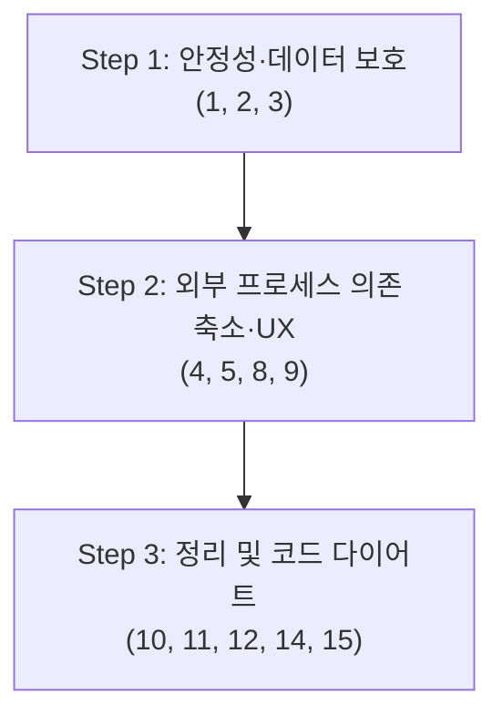

# 📋 DeckDeckDeck 코드 현대화 체크리스트

이 문서는 코드베이스를 검색(grep)과 핵심 파일 열람으로 조사해, **속도·안정성·이식성·UX·단순화** 측면에서 현대화할 만한 항목을 정리한 것입니다. 기존 체크리스트는 모두 폐기하고 새로 작성했습니다.

> 💡 **규칙**: 해결한 항목은 `- [x]`로 바꾸고 항목명에 취소선(`~~...~~`)을 긋습니다.
>
> ⚠️ **조사 범위 안내**: 이번 조사는 전체 파일 정독이 아니라 **패턴 검색 + 일부 파일 직접 확인**입니다. 항목마다 `확인됨`(코드를 직접 읽음) / `후보`(검색 결과만 봄, 착수 전 재확인 필요)를 표시했습니다. 코드는 한 줄도 수정하지 않았습니다.

---

## 📋 전체 요약 체크리스트

| 체크 | 구분 | 항목명 | 관련 위치 | 심각도 / 성격 | 상태 |
| :---: | :---: | :--- | :--- | :---: | :---: |
| - [ ] | 안정성 | [1. 클립보드 복원 대기가 `finally`에서 블로킹](#1-클립보드-복원-대기가-finally에서-블로킹) | [`ClipboardPasteGateway.cs`](file:///c:/Users/joajo/AndroidStudioProjects/deckdeckdeck/src/DeckDeckDeck.App/Infrastructure/Gateways/ClipboardPasteGateway.cs#L97-L126) | 🔴 높음 | 확인됨 |
| - [ ] | 안정성 | [2. 설정 비밀값이 PC에 묶인 DPAPI 암호화](#2-설정-비밀값이-pc에-묶인-dpapi-암호화) | [`ProtectedSettingValueCodec.cs`](file:///c:/Users/joajo/AndroidStudioProjects/deckdeckdeck/src/DeckDeckDeck.App/Infrastructure/Persistence/ProtectedSettingValueCodec.cs#L22-L48) | 🔴 높음 | 확인됨 |
| - [ ] | 안정성 | [3. 저수준 키보드 훅 생명주기 점검](#3-저수준-키보드-훅-생명주기-점검) | [`GlobalHotkeyRegistrar.cs`](file:///c:/Users/joajo/AndroidStudioProjects/deckdeckdeck/src/DeckDeckDeck.App/Infrastructure/Platform/GlobalHotkeyRegistrar.cs#L251-L270) | 🔴 높음 | 후보 |
| - [ ] | 외부 우회 | [4. 터미널 명령을 임시 .cmd/.ps1 파일로 실행](#4-터미널-명령을-임시-cmdps1-파일로-실행) | [`TerminalCommandGatewayAdapter.cs`](file:///c:/Users/joajo/AndroidStudioProjects/deckdeckdeck/src/DeckDeckDeck.App/Infrastructure/Gateways/TerminalCommandGatewayAdapter.cs#L91-L180) | 🟠 중간 | 확인됨(일부) |
| - [ ] | 외부 우회 | [5. 시작 프로그램 등록을 `schtasks.exe` 프로세스로 처리](#5-시작-프로그램-등록을-schtasksexe-프로세스로-처리) | [`WindowsStartupRegistrationGateway.cs`](file:///c:/Users/joajo/AndroidStudioProjects/deckdeckdeck/src/DeckDeckDeck.App/Infrastructure/Platform/WindowsStartupRegistrationGateway.cs#L221-L300) | 🟠 중간 | 확인됨(일부) |
| - [ ] | 블로킹 | [6. 블로킹 `.Result` 사용 지점](#6-블로킹-result-사용-지점) | `InstalledAppPickerWindow.cs` 외 | 🟠 중간 | 후보 |
| - [ ] | 블로킹 | [7. 고정 딜레이 의존(붙여넣기·핫키·Spotify)](#7-고정-딜레이-의존붙여넣기핫키spotify) | 아래 표 참조 | 🟠 중간 | 확인됨(일부) |
| - [ ] | UX | [8. `MessageBox.Show` 모달 → 비활성 토스트](#8-messageboxshow-모달--비활성-토스트) | [`App.xaml.cs`](file:///c:/Users/joajo/AndroidStudioProjects/deckdeckdeck/src/DeckDeckDeck.App/App.xaml.cs#L349-L365), [`DialogAdapter.cs`](file:///c:/Users/joajo/AndroidStudioProjects/deckdeckdeck/src/DeckDeckDeck.App/Infrastructure/Platform/DialogAdapter.cs#L15-L28) | 🟠 중간 | 확인됨 |
| - [ ] | 디자인 | [9. XAML 하드코딩 색상 → 테마 토큰](#9-xaml-하드코딩-색상--테마-토큰) | `HotkeyEditView`, `SnippetEditView`, `MainWindow` | 🟡 낮음 | 확인됨 |
| - [ ] | 자원 | [10. `HttpClient` 직접 생성](#10-httpclient-직접-생성) | Spotify 어댑터 2곳 | 🟡 낮음 | 확인됨 |
| - [ ] | 자원 | [11. 임시 스크립트 파일 정리 정책](#11-임시-스크립트-파일-정리-정책) | `TerminalCommandGatewayAdapter.cs` | 🟡 낮음 | 후보 |
| - [ ] | 단순화 | [12. `HotkeyEditViewModel`·`SnippetEditViewModel` 중복](#12-hotkeyeditviewmodelsnippeteditviewmodel-중복) | 두 뷰모델 (809줄 / 758줄) | ✂️ 코드 다이어트 | 후보 |
| - [ ] | 단순화 | [13. `Func<ProcessStartInfo, Process?>` 주입 반복](#13-funcprocessstartinfo-process-주입-반복) | 게이트웨이 4개 | ✂️ 코드 다이어트 | 확인됨 |
| - [ ] | 단순화 | [14. `?? SnippetTerminalShell.Cmd` 기본값 중복](#14-snippetterminalshellcmd-기본값-중복) | 9곳 | ✂️ 코드 다이어트 | 확인됨 |
| - [ ] | 단순화 | [15. 비대 파일 분리 검토](#15-비대-파일-분리-검토) | 500줄 안팎 파일 7개 | ✂️ 아키텍처 | 후보 |

> ✅ **이미 잘 되어 있어 제외한 것**: SQLite는 [`AppDbContextFactory.cs`](file:///c:/Users/joajo/AndroidStudioProjects/deckdeckdeck/src/DeckDeckDeck.App/Data/AppDbContextFactory.cs#L40-L44)에서 `WAL` + `busy_timeout=5000`이 이미 적용되어 있고 `Cache=Shared`도 없습니다. 하드코딩된 `C:\` 경로, `SendKeys`, `async void` 남발은 검색에서 발견되지 않았습니다.

---

## 1부. ⚠️ 안정성·데이터 보호 (Critical & High)

### 1. 클립보드 복원 대기가 `finally`에서 블로킹
- **관련 파일**: [`ClipboardPasteGateway.cs` (L97-L126)](file:///c:/Users/joajo/AndroidStudioProjects/deckdeckdeck/src/DeckDeckDeck.App/Infrastructure/Gateways/ClipboardPasteGateway.cs#L97-L126)
- **어떤 문제인가요?**
  - 붙여넣기 흐름이 `try`의 `Task.Delay(_pasteDelay)` → `finally`의 `Task.Delay(_restoreDelay)`로 끝납니다. 즉, 붙여넣기가 끝난 뒤에도 복원 대기 시간만큼 호출자가 기다립니다.
  - `finally` 안의 `await`는 취소 시 복원이 건너뛰어질 수 있고, 복원 중 예외가 나면 원래 예외/결과를 덮어쓸 수 있습니다. (`TryRestoreClipboard`가 예외를 삼키는 것으로 보여 덮어쓰기 위험은 낮으나 재확인 필요)
- **실제 영향**: 연속 단축키 입력 시 다음 붙여넣기가 늦게 시작되거나, 대기 중 사용자가 직접 복사하면 사용자의 클립보드를 옛 값으로 덮어쓸 수 있습니다.
- **현대화 개선 방안**
  - 결과(`Success`/`Failure`)를 먼저 반환하고, 복원은 `_ = RestoreClipboardLaterAsync(backup)`처럼 백그라운드로 위임합니다.
  - 복원 직전에 클립보드 시퀀스 번호(`GetClipboardSequenceNumber`)가 우리가 설정한 값 그대로일 때만 복원해서, 사용자가 그 사이에 복사한 내용을 보호합니다.
  - 고정 `_pasteDelay`는 "대상 창이 포그라운드가 되었는지"를 짧게 폴링(예: 10ms 간격, 최대 N ms)하는 방식으로 줄입니다.
- **기대 효과**: 🚀 붙여넣기 호출 즉시 반환, 사용자 클립보드 덮어쓰기 사고 방지.
- **검증**: 기존 `MainViewModelPasteTests` 등 붙여넣기 관련 테스트 + 복원 시점 테스트 추가.

### 2. 설정 비밀값이 PC에 묶인 DPAPI 암호화
- **관련 파일**: [`ProtectedSettingValueCodec.cs` (L22-L48)](file:///c:/Users/joajo/AndroidStudioProjects/deckdeckdeck/src/DeckDeckDeck.App/Infrastructure/Persistence/ProtectedSettingValueCodec.cs#L22-L48)
- **어떤 문제인가요?**
  - `DataProtectionScope.CurrentUser` 암호화는 **같은 Windows 계정·같은 PC**에서만 풀립니다. 백업 복원이나 PC 교체 시 `TryUnprotect`는 `false`를 반환합니다.
  - 그런데 [`Unprotect`(L45-L48)](file:///c:/Users/joajo/AndroidStudioProjects/deckdeckdeck/src/DeckDeckDeck.App/Infrastructure/Persistence/ProtectedSettingValueCodec.cs#L45-L48)는 실패 시 **빈 문자열을 조용히 반환**합니다.
- **실제 영향**: 복원 후 Spotify 연결 같은 기능이 "설정이 없는 상태"로 보이고, 사용자는 이유를 알 수 없습니다. (`Unprotect` 호출처가 `TryUnprotect`를 쓰는지 먼저 확인 필요)
- **현대화 개선 방안**
  - `Unprotect`를 쓰는 호출처를 찾아 모두 `TryUnprotect`로 전환하고, 실패 시 "다시 로그인/재연결이 필요합니다" 상태를 UI에 표시합니다.
  - 호출처가 없으면 `Unprotect`는 제거합니다(요청 시).
  - 백업(`BackupGateway`)에 비밀값을 포함할지 정책을 정하고, 포함하지 않는다면 복원 후 재인증 안내를 명시합니다.
- **기대 효과**: 🛡️ 조용한 데이터 증발 대신 명확한 재인증 안내.
- **사용자 결정 필요**: 백업에 토큰을 포함할지 여부.

### 3. 저수준 키보드 훅 생명주기 점검
- **관련 파일**: [`GlobalHotkeyRegistrar.cs` (L26-L41, L181-L189, L251-L270)](file:///c:/Users/joajo/AndroidStudioProjects/deckdeckdeck/src/DeckDeckDeck.App/Infrastructure/Platform/GlobalHotkeyRegistrar.cs#L251-L270), [`User32.cs` (L19-L26)](file:///c:/Users/joajo/AndroidStudioProjects/deckdeckdeck/src/DeckDeckDeck.App/Native/User32.cs#L19-L26)
- **현재 상태**: `RegisterHotKey`가 실패한 키만 저수준 훅(`WH_KEYBOARD_LL`)으로 대체(fallback)하고, `Dispose`·재등록 시 `UnhookWindowsHookEx`를 호출하는 구조입니다. 설계 자체는 적절합니다.
- **점검할 것 (후보)**
  - 훅 콜백이 느리면 Windows가 훅을 자동 해제하거나 전체 키 입력이 지연됩니다. 콜백 안에서 무거운 일을 하지 않고 즉시 큐에 넘기는지 확인합니다.
  - `_hookFallbackKeysDown`이 창 포커스 변화·화면 잠금 후 "눌린 상태"로 남는지(키 씹힘) 확인합니다.
  - 앱 비정상 종료 경로에서도 `Dispose`가 호출되는지 확인합니다.
- **기대 효과**: 🚀 타 앱 타이핑 지연·키 씹힘 방지.

---

## 2부. ⚡ 반응성·UX·플랫폼 현대화

### 4. 터미널 명령을 임시 .cmd/.ps1 파일로 실행
- **관련 파일**: [`TerminalCommandGatewayAdapter.cs` (L20, L91, L144-L180, L252)](file:///c:/Users/joajo/AndroidStudioProjects/deckdeckdeck/src/DeckDeckDeck.App/Infrastructure/Gateways/TerminalCommandGatewayAdapter.cs#L91-L180)
- **현재 동작**: `%TEMP%\DeckDeckDeck\commands`에 `.cmd`/`.ps1` 스크립트를 만들고 `cmd.exe`/`powershell.exe`로 실행합니다.
- **문제점**
  - 파일 쓰기 → 프로세스 생성 → 파일 정리까지 단계가 많고, 안티바이러스가 임시 스크립트를 검사·차단할 수 있습니다.
  - 임시 폴더 파일은 다른 프로세스가 실행 전에 바꿀 수 있어 보안상 약합니다(같은 사용자 권한 내에서).
- **현대화 개선 방안**
  - `cmd /c`는 `ProcessStartInfo.ArgumentList`로, PowerShell은 `-EncodedCommand`(UTF-16LE Base64)로 **파일 없이** 전달하는 방식을 검토합니다.
  - 단, 여러 줄 스크립트·긴 명령(명령줄 길이 제한 약 32K)·"터미널 창 유지" 옵션 때문에 **파일 방식이 더 나은 경우도 있습니다.** 기능 손실이 없는지 테스트(`TerminalCommandGatewayAdapterTests`)로 먼저 확인해야 합니다.
- **기대 효과**: 🚀 실행 지연 감소, 임시 파일·정리 코드 제거(항목 11 해소).
- **사용자 결정 필요**: 여러 줄 스크립트 지원을 유지할지.

### 5. 시작 프로그램 등록을 `schtasks.exe` 프로세스로 처리
- **관련 파일**: [`WindowsStartupRegistrationGateway.cs` (L221-L300)](file:///c:/Users/joajo/AndroidStudioProjects/deckdeckdeck/src/DeckDeckDeck.App/Infrastructure/Platform/WindowsStartupRegistrationGateway.cs#L221-L300)
- **현재 동작**: `schtasks.exe`를 실행하고 출력 문자열을 파싱하며, 타임아웃이 최대 120초(`SchtasksTimeoutMilliseconds`)입니다. 동기 `WaitForExit`와 `outputTask.Result`로 기다립니다.
- **문제점**: 출력 문자열 파싱은 Windows 언어(한국어/영어)에 따라 달라질 수 있고, 설정 화면에서 호출되면 최대 2분간 멈출 수 있습니다.
- **현대화 개선 방안**
  - 작업 스케줄러를 쓰는 이유(예: 관리자 권한 시작, 로그온 지연)를 먼저 확인합니다. 이유가 없다면 `HKCU\...\Run` 레지스트리가 훨씬 가볍습니다.
  - 작업 스케줄러가 꼭 필요하면 `TaskScheduler` 라이브러리(NuGet)나 COM 인터페이스 사용을 검토합니다(새 라이브러리 추가이므로 승인 필요).
  - 최소한 호출부를 `Task.Run`으로 감싸 UI 스레드 블로킹을 막고 타임아웃을 줄입니다.
- **기대 효과**: 🚀 설정 화면 프리징 방지, 언어 독립성.
- **사용자 결정 필요**: 작업 스케줄러를 유지해야 하는 이유.

### 6. 블로킹 `.Result` 사용 지점
- **관련 파일**
  - [`InstalledAppPickerWindow.cs` (L376)](file:///c:/Users/joajo/AndroidStudioProjects/deckdeckdeck/src/DeckDeckDeck.App/Infrastructure/Platform/InstalledAppPickerWindow.cs#L376): `task.IsCompletedSuccessfully ? task.Result : ...` — 완료 확인 후 읽으므로 **안전한 사용**입니다. 변경 불필요.
  - [`WindowsBluetoothGattBatteryReader.cs` (L199)](file:///c:/Users/joajo/AndroidStudioProjects/deckdeckdeck/src/DeckDeckDeck.App/Infrastructure/Platform/WindowsBluetoothGattBatteryReader.cs#L199): `completedTask.Result` — `WhenAny` 이후라면 안전. 재확인만.
  - [`WindowsStartupRegistrationGateway.cs` (L278-L279)](file:///c:/Users/joajo/AndroidStudioProjects/deckdeckdeck/src/DeckDeckDeck.App/Infrastructure/Platform/WindowsStartupRegistrationGateway.cs#L278-L279): 프로세스 종료 후 읽기. 항목 5와 함께 처리.
- **결론**: 위험한 데드락 패턴은 발견되지 않았습니다. 별도 작업 불필요, 항목 5에 흡수합니다.

### 7. 고정 딜레이 의존(붙여넣기·핫키·Spotify)
| 위치 | 용도 | 현대화 방향 |
| :--- | :--- | :--- |
| [`ClipboardPasteGateway.cs` L104, L122](file:///c:/Users/joajo/AndroidStudioProjects/deckdeckdeck/src/DeckDeckDeck.App/Infrastructure/Gateways/ClipboardPasteGateway.cs#L104) | 창 활성화 대기 / 복원 대기 | 항목 1 참조 (포그라운드 확인 폴링) |
| [`SpotifyMediaActionGatewayAdapter.cs` L292](file:///c:/Users/joajo/AndroidStudioProjects/deckdeckdeck/src/DeckDeckDeck.App/Infrastructure/Gateways/SpotifyMediaActionGatewayAdapter.cs#L292) | 기기 목록 폴링 | 이미 `CancellationToken` 사용. 총 대기 한도·백오프 확인 |
| [`AutoBackupCoordinator.cs` L104](file:///c:/Users/joajo/AndroidStudioProjects/deckdeckdeck/src/DeckDeckDeck.App/Composition/AutoBackupCoordinator.cs#L104) | 자동 백업 디바운스 | **정상 패턴**(디바운스+취소). 변경 불필요 |
| [`GlobalHotkeyRegistrar.cs` L50](file:///c:/Users/joajo/AndroidStudioProjects/deckdeckdeck/src/DeckDeckDeck.App/Infrastructure/Platform/GlobalHotkeyRegistrar.cs#L50) | 지연 함수로 `Task.Delay` 주입 | 테스트 주입용. 변경 불필요 |

- **결론**: 실제로 손볼 것은 **붙여넣기 2곳(항목 1)**뿐입니다.

### 8. `MessageBox.Show` 모달 → 비활성 토스트
- **관련 파일**: [`App.xaml.cs` (L349, L359)](file:///c:/Users/joajo/AndroidStudioProjects/deckdeckdeck/src/DeckDeckDeck.App/App.xaml.cs#L349-L365), [`DialogAdapter.cs` (L15-L28)](file:///c:/Users/joajo/AndroidStudioProjects/deckdeckdeck/src/DeckDeckDeck.App/Infrastructure/Platform/DialogAdapter.cs#L15-L28)
- **현재 동작**: 시작 안내/시작 실패는 모달 `MessageBox`로 표시합니다.
- **판단**
  - **시작 실패(L359)**: 앱이 아직 UI를 못 띄운 상황이라 모달이 적절합니다. **유지 권장.**
  - **이미 실행 중 안내(L349)**: 사용자가 방금 실행을 시도했으므로 모달이 자연스럽습니다. 다만 [`WpfToastNotificationGateway`](file:///c:/Users/joajo/AndroidStudioProjects/deckdeckdeck/src/DeckDeckDeck.App/Infrastructure/Gateways/WpfToastNotificationGateway.cs)가 이미 있어 토스트로 바꿀 수 있습니다.
  - **`DialogAdapter`**: 삭제 확인 등 **사용자 판단이 필요한 대화상자는 모달이 맞습니다.** 알림성 메시지만 토스트로 옮깁니다.
- **현대화 개선 방안**: "알림성" `MessageBox`만 기존 토스트로 전환. 확인/선택형은 유지.
- **기대 효과**: 🎯 작업 중인 앱의 포커스를 빼앗지 않음.
- **주의**: 이 항목은 효과가 작고 취향 영역이 섞여 있어 우선순위가 낮습니다.

### 9. XAML 하드코딩 색상 → 테마 토큰
- **관련 파일**: [`Theme.xaml`](file:///c:/Users/joajo/AndroidStudioProjects/deckdeckdeck/src/DeckDeckDeck.App/Views) (토큰 정의 22곳, 정상) / `HotkeyEditView.xaml` (4곳) / `SnippetEditView.xaml` (4곳) / `MainWindow.xaml` (2곳)
- **문제점**: 색상 토큰은 `Theme.xaml`에 잘 모여 있으나, 위 3개 뷰에 `#RRGGBB` 직접 지정이 남아 있습니다. (`docs/DESIGN_GUIDELINES.md` 기준 확인 필요)
- **현대화 개선 방안**: 같은 의미의 색이 `Theme.xaml`에 있으면 `{DynamicResource ...}`로 교체하고, 없으면 토큰을 추가합니다.
- **기대 효과**: 🎨 화면 통일감, 향후 테마 변경 용이.
- **착수 전**: UI 작업이므로 `docs/DESIGN_GUIDELINES.md` 확인과 `ViewRenderingTests` 실행이 필요합니다.

---

## 3부. 🧹 자원·정리

### 10. `HttpClient` 직접 생성
- **관련 파일**: [`SpotifyConnectionGatewayAdapter.cs` (L33)](file:///c:/Users/joajo/AndroidStudioProjects/deckdeckdeck/src/DeckDeckDeck.App/Infrastructure/Gateways/SpotifyConnectionGatewayAdapter.cs#L33), [`SpotifyMediaActionGatewayAdapter.cs` (L31)](file:///c:/Users/joajo/AndroidStudioProjects/deckdeckdeck/src/DeckDeckDeck.App/Infrastructure/Gateways/SpotifyMediaActionGatewayAdapter.cs#L31)
- **현재 구조**: 어댑터마다 `httpClient ?? new HttpClient()`로 각자 인스턴스를 만듭니다.
- **문제점**: 어댑터가 앱 수명 동안 하나씩만 만들어진다면 문제가 없습니다(싱글톤 사용 시 DNS 갱신 이슈는 `SocketsHttpHandler.PooledConnectionLifetime`으로 해결). **어댑터가 반복 생성되는지 [`AppComposition.cs`](file:///c:/Users/joajo/AndroidStudioProjects/deckdeckdeck/src/DeckDeckDeck.App/Composition/AppComposition.cs)에서 확인**해야 합니다.
- **개선 방안**: 반복 생성되면 조합 루트(`AppComposition`)에서 공유 `HttpClient` 하나를 만들어 두 어댑터에 주입합니다.
- **기대 효과**: 소켓 고갈 방지(반복 생성 시에만 의미 있음).

### 11. 임시 스크립트 파일 정리 정책
- **관련 파일**: [`TerminalCommandGatewayAdapter.cs`](file:///c:/Users/joajo/AndroidStudioProjects/deckdeckdeck/src/DeckDeckDeck.App/Infrastructure/Gateways/TerminalCommandGatewayAdapter.cs) (L252 부근에서 `.cmd` 확장자 검사, 정리 로직 존재 추정)
- **점검할 것**: 오래된 스크립트를 앱 시작 시 일괄 삭제하는지, 실행 직후 삭제 시 터미널 창 유지 옵션과 충돌하지 않는지 확인합니다.
- **개선 방안**: 시작 시 `N일` 지난 파일 정리를 백그라운드로 수행. 항목 4를 채택하면 이 항목은 소멸합니다.

---

## 4부. ✂️ 중복 코드 및 단순화 (Code Simplification)

### 12. `HotkeyEditViewModel`·`SnippetEditViewModel` 중복
- **관련 파일**: [`HotkeyEditViewModel.cs`](file:///c:/Users/joajo/AndroidStudioProjects/deckdeckdeck/src/DeckDeckDeck.App/ViewModels/HotkeyEditViewModel.cs) (809줄), [`SnippetEditViewModel.cs`](file:///c:/Users/joajo/AndroidStudioProjects/deckdeckdeck/src/DeckDeckDeck.App/ViewModels/SnippetEditViewModel.cs) (758줄)
- **현재 구조**: 프로젝트에서 가장 큰 두 프로덕션 파일입니다. 이미 [`ExecutableActionEditDraft.cs`](file:///c:/Users/joajo/AndroidStudioProjects/deckdeckdeck/src/DeckDeckDeck.App/UseCases/ExecutableActionEditDraft.cs)(382줄)로 공통 로직 일부가 추출되어 있어, **남은 중복이 얼마인지 먼저 측정**해야 합니다.
- **개선 방안**
  1. 두 파일의 공통 멤버/명령/검증을 비교해 중복 줄 수를 측정합니다.
  2. 중복이 큰 부분만 `ExecutableActionEditDraft` 쪽으로 더 옮기거나, 공통 표시용 속성 묶음으로 합칩니다.
  3. 상속 기반 베이스 클래스는 지양하고 **조합(composition)** 을 우선합니다(`AGENTS.md`/`code-simplification` 방침).
- **기대 효과**: ✂️ 수십~수백 줄 감소 가능(측정 전이라 수치 미확정).
- **검증**: `SnippetEditViewModelTests`, `ExecutableActionEditDraftTests` 등 기존 테스트가 그대로 통과해야 합니다.

### 13. `Func<ProcessStartInfo, Process?>` 주입 반복
- **관련 파일**: [`FileLaunchGatewayAdapter.cs`](file:///c:/Users/joajo/AndroidStudioProjects/deckdeckdeck/src/DeckDeckDeck.App/Infrastructure/Gateways/FileLaunchGatewayAdapter.cs), [`UrlLaunchGatewayAdapter.cs`](file:///c:/Users/joajo/AndroidStudioProjects/deckdeckdeck/src/DeckDeckDeck.App/Infrastructure/Gateways/UrlLaunchGatewayAdapter.cs), [`SpotifyAppLaunchGatewayAdapter.cs`](file:///c:/Users/joajo/AndroidStudioProjects/deckdeckdeck/src/DeckDeckDeck.App/Infrastructure/Gateways/SpotifyAppLaunchGatewayAdapter.cs), `TerminalCommandGatewayAdapter.cs`
- **현재 구조**: 4개 어댑터가 모두 같은 형태의 "기본 생성자 → `Process.Start` 전달 + 테스트용 internal 생성자" 보일러플레이트를 갖습니다.
- **판단**: 테스트를 위해 의도된 설계라 **기능상 문제는 없습니다.** 줄 수 절감 효과도 작습니다.
- **개선 방안(선택)**: 공통 `ProcessLauncher` 하나로 합치는 안이 있으나, 얕은 래퍼가 하나 더 생길 수 있어 **권장하지 않습니다.** 필요하면 보류하세요.

### 14. `?? SnippetTerminalShell.Cmd` 기본값 중복
- **관련 위치**: [`ExecutableActionStorageRules.cs` L56](file:///c:/Users/joajo/AndroidStudioProjects/deckdeckdeck/src/DeckDeckDeck.App/Domain/ExecutableActionStorageRules.cs#L56), [`SnippetRules.cs` L23](file:///c:/Users/joajo/AndroidStudioProjects/deckdeckdeck/src/DeckDeckDeck.App/Domain/SnippetRules.cs#L23), [`ExecutableActionEditDraft.cs` L192/200/379/404/429](file:///c:/Users/joajo/AndroidStudioProjects/deckdeckdeck/src/DeckDeckDeck.App/UseCases/ExecutableActionEditDraft.cs#L192), [`ExecuteSnippetActionUseCase.cs` L217](file:///c:/Users/joajo/AndroidStudioProjects/deckdeckdeck/src/DeckDeckDeck.App/UseCases/ExecuteSnippetActionUseCase.cs#L217), [`HotkeyActionUseCases.cs` L116](file:///c:/Users/joajo/AndroidStudioProjects/deckdeckdeck/src/DeckDeckDeck.App/UseCases/HotkeyActionUseCases.cs#L116), [`SnippetUseCases.cs` L41](file:///c:/Users/joajo/AndroidStudioProjects/deckdeckdeck/src/DeckDeckDeck.App/UseCases/SnippetUseCases.cs#L41)
- **문제점**: "기본 셸은 cmd"라는 도메인 규칙이 9곳에 흩어져 있습니다. 기본값을 바꾸면 한 곳이라도 빠지면 불일치가 생깁니다.
- **개선 방안**: `Domain`에 상수 한 줄(`SnippetTerminalShell.Default` 상수 또는 확장 메서드 `OrDefault()`)을 두고 교체합니다. 변경은 작고 안전합니다.
- **기대 효과**: 규칙 일원화. 줄 수는 거의 같음.

### 15. 비대 파일 분리 검토
| 파일 | 줄 수 | 검토 포인트 |
| :--- | :---: | :--- |
| [`WindowsBluetoothDeviceScanner.cs`](file:///c:/Users/joajo/AndroidStudioProjects/deckdeckdeck/src/DeckDeckDeck.App/Infrastructure/Platform/WindowsBluetoothDeviceScanner.cs) | 546 | 스캔/병합/배터리 매핑 분리 여부 |
| [`SpotifyMediaActionGatewayAdapter.cs`](file:///c:/Users/joajo/AndroidStudioProjects/deckdeckdeck/src/DeckDeckDeck.App/Infrastructure/Gateways/SpotifyMediaActionGatewayAdapter.cs) | 494 | HTTP 호출/기기 선택/폴링 분리 여부 |
| [`MainViewModel.cs`](file:///c:/Users/joajo/AndroidStudioProjects/deckdeckdeck/src/DeckDeckDeck.App/ViewModels/MainViewModel.cs) | 454 | 상단바 블루투스 표시 상태(L413 부근) 분리 여부 |
| [`AppComposition.cs`](file:///c:/Users/joajo/AndroidStudioProjects/deckdeckdeck/src/DeckDeckDeck.App/Composition/AppComposition.cs) | 447 | 조합 루트라 크기가 자연스러움. **분리 불필요 가능성 높음** |
| [`WindowsBluetoothGattBatteryReader.cs`](file:///c:/Users/joajo/AndroidStudioProjects/deckdeckdeck/src/DeckDeckDeck.App/Infrastructure/Platform/WindowsBluetoothGattBatteryReader.cs) | 442 | 단일 책임이면 유지 |
| [`SettingsViewModel.cs`](file:///c:/Users/joajo/AndroidStudioProjects/deckdeckdeck/src/DeckDeckDeck.App/ViewModels/SettingsViewModel.cs) | 440 | 섹션별 분리 여부 |
| [`InstalledAppPickerWindow.cs`](file:///c:/Users/joajo/AndroidStudioProjects/deckdeckdeck/src/DeckDeckDeck.App/Infrastructure/Platform/InstalledAppPickerWindow.cs) | 429 | 코드로 만든 UI(XAML 없음)라 큰 편 |

- **판단**: 대부분 500줄 미만이고 이미 책임별로 파일이 나뉘어 있습니다. **줄 수만으로 분리하지 말고**, 한 파일에서 변경 이유가 둘 이상 섞인 곳(Spotify 어댑터, `MainViewModel`)만 우선 검토하세요.

---

## 5부. 🗺️ 권장 현대화 로드맵

1. **Step 1 (안정성·데이터 보호)**
   - [ ] 1. 클립보드 복원을 백그라운드화하고 시퀀스 번호로 보호
   - [ ] 2. DPAPI 복호화 실패 시 조용한 빈 값 반환 제거 + 재인증 안내
   - [ ] 3. 키보드 훅 콜백 경량화·눌림 상태 초기화 점검
2. **Step 2 (외부 프로세스 의존 축소·UX)**
   - [ ] 4. 터미널 실행을 파일 없는 방식으로 전환 가능한지 검증 후 적용
   - [ ] 5. 시작 프로그램 등록 방식 재검토(레지스트리 Run vs 작업 스케줄러) + UI 비블로킹
   - [ ] 8. 알림성 `MessageBox`만 토스트로 전환
   - [ ] 9. XAML 하드코딩 색상을 테마 토큰으로 교체
3. **Step 3 (정리 및 코드 다이어트)**
   - [ ] 10. `HttpClient` 생성 위치 확인 후 필요 시 공유
   - [ ] 11. 임시 스크립트 정리 정책 확인
   - [ ] 12. 두 편집 뷰모델의 남은 중복 측정 후 통합
   - [ ] 14. 기본 셸 `Cmd` 기본값을 한 곳으로 모으기
   - [ ] 15. 책임이 섞인 파일만 선별 분리
   - [ ] (보류 권장) 13. 프로세스 실행 주입 보일러플레이트 통합

---

## 📎 참고: 항목 선별 기준

- 변수명 변경, 주석 정리 등 **취향성 변경은 제외**했습니다.
- 이득이 없거나 이미 올바른 코드(`AutoBackupCoordinator`의 디바운스, `InstalledAppPickerWindow`의 `.Result`, SQLite WAL 설정)는 목록에서 **명시적으로 제외**했습니다.
